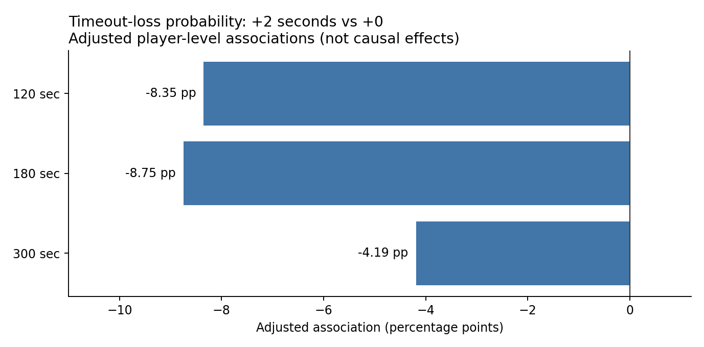

# Do Chess Clock Increments Reduce Timeout Losses?

**An observational causal-inference study of Lichess rated games (January 2013)**

> **Headline:** Choosing a queue with a **2-second per-move increment** was associated with a lower probability of losing on time at 2-, 3-, and 5-minute starting clocks. These are **adjusted associations, not causally identified effects**.

## Research question

For Lichess rated games with starting clocks of 120, 180, or 300 seconds, how is selecting a **+2-second increment queue**, rather than a **+0 queue** at the same starting clock, associated with a player's probability of losing on time? Under which assumptions could the comparison have a causal interpretation?

**Primary policy pairs:** `120+0` vs `120+2`; `180+0` vs `180+2`; `300+0` vs `300+2`. **Secondary:** `300+0` vs `300+5`.

## Key results

| Starting clock | +0 games | +2 games | Timeout-loss rate +0 | Timeout-loss rate +2 | Adjusted difference (pp) |
|:--|--:|--:|--:|--:|--:|
| 2 min (120s) | 5,950 | 1,212 | 20.64% | 11.80% | **−8.35** |
| 3 min (180s) | 8,243 | 1,194 | 20.79% | 12.48% | **−8.75** |
| 5 min (300s) | 10,172 | 2,991 | 14.97% | 11.12% | **−4.19** |

These are player-level regression-adjusted differences. Uncertainty intervals, including matching game-level dyadic estimates and intervals, are documented in the [full report](reports/final_research_report.md).



- **Sample:** 29,762 games (59,524 player-game rows) involving 2,819 unique players.
- **Pooled descriptive adjusted association:** −6.64 percentage points, using the observed game-count weights across the three starting-clock strata; no pooled CI was computed.
- **Robustness:** IPW, cross-fitted AIPW, and game-level dyadic analyses yielded similarly negative estimates. Within-player fixed effects also remained negative but were larger; they target a different population and comparison.
- **Secondary policy:** `300+5` vs `300+0` gave an adjusted difference of approximately −6.96 percentage points; this is **not** proof of a causal dose response.

## Why this isn't a randomized experiment

Players choose time controls. Preferences, time-management skill, fatigue, and motivations may influence both increment selection and timeout losses. Additionally, choosing a different queue may alter the opponent encountered. Thus, this research describes **queue-choice comparisons**, not the clock-only effect of adding time while holding the same opponent fixed. Conditioning on opponent characteristics may change the question being answered.

## Methods at a glance

1. Validate PGN-derived game and player-game tables and code decisive time forfeits as player-level timeout losses; preserve time-forfeit draws as non-losses.
2. Compare precisely defined time controls **within** each starting-clock stratum.
3. Estimate unadjusted differences and linear probability models adjusted for pre-game focal-player Elo and cyclical UTC hour.
4. Examine within-player fixed-effects associations among players observed using both policies.
5. Check inverse-propensity weighting (IPW), cross-fitted augmented IPW (AIPW), weighted covariate balance, game-level dyadic variance approximations, and hypothetical unmeasured-confounder bias scenarios.

See [Full research report](reports/final_research_report.md) for model results, uncertainty, assumptions, and limitations.

## Project structure

```text
lichess-increment-causal-inference/
├── data/
│   ├── raw/                        # Keep local: original Lichess PGN
│   └── processed/                  # Keep local: generated CSVs
├── notebooks/
│   ├── 01_data_validation.ipynb
│   ├── 02_exploratory_analysis.ipynb
│   ├── 03_causal_design.ipynb
│   ├── 04_causal_estimation.ipynb
│   └── 05_sensitivity_and_robust_inference.ipynb
├── src/
│   └── prepare_increment_data.py
├── results/
│   ├── tables/                     # Recreated by analysis notebooks
│   └── figures/
│       └── adjusted_associations.png
├── reports/
│   └── final_research_report.md
├── requirements.txt
└── README.md
```

## Reproduce the analysis

1. Obtain the January 2013 Lichess standard rated PGN dataset from the [Lichess open database](https://database.lichess.org/). Place it in `data/raw/`. The source PGN is **not** committed to this repository.
2. Create and activate a Python virtual environment, then install the project's dependencies (if `requirements.txt` exists, use it). Example on Windows PowerShell:

   ```powershell
   python -m venv .venv
   .\.venv\Scripts\Activate.ps1
   python -m pip install -r requirements.txt
   ```
3. From the repo root, regenerate the processed files (replace the PGN filename as appropriate):

   ```powershell
   python src/prepare_increment_data.py --input "data/raw/lichess_db_standard_rated_2013-01.pgn" --outdir "data/processed"
   ```
4. Run notebooks **01 → 05**, from the repo root or notebooks folder, selecting the `.venv` kernel. The later notebooks write analysis tables to `results/tables/`.

> **Environment note:** The processing script supplied with this project uses pandas. The notebooks additionally use packages such as NumPy, Matplotlib, SciPy, scikit-learn, and statsmodels. Keep `requirements.txt` synchronized with the versions you actually ran.

## Interpretation and limitations

The observed negative associations are robust across several **measured-covariate adjustment strategies**, but these analyses cannot rule out unmeasured selection into time controls. The player-game data contain two dependent observations per game and repeat players across games. A dyadic game-level sensitivity model addresses some shared-player dependence but is not equivalent to the player-level estimand. The source data cover **one month in 2013**, limiting generalizability to the current Lichess environment. The outcome concerns **losing on time**, not overall win rate or chess skill.

## Data and attribution

Data source: [Lichess open database](https://database.lichess.org/) — standard rated games, January 2013. Follow the dataset provider's attribution, privacy, and licensing terms when publishing or redistributing any source data. This repo is designed to keep raw and processed game data out of version control.
